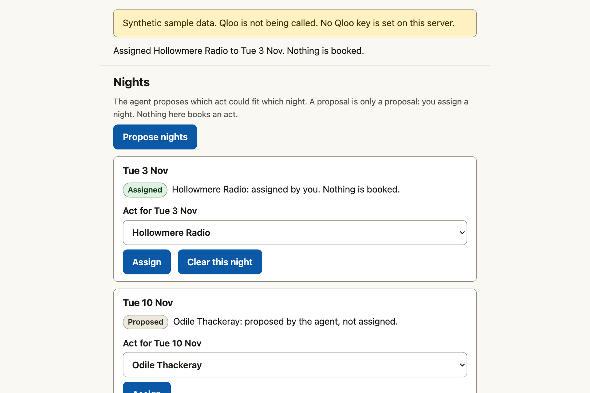
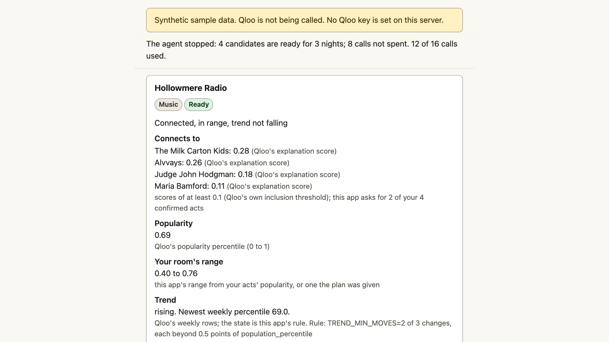
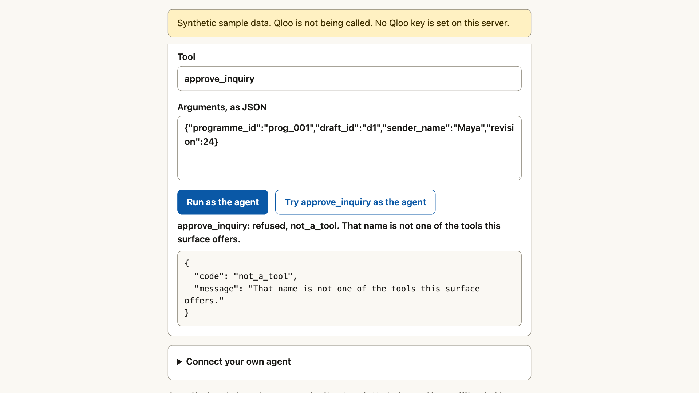

# Open Slot

**Fill your venue's dark nights with acts your regulars already love: an agent finds the
musicians, comedians and podcasters whose audiences overlap yours, shows the evidence, and drafts
the inquiry. Only you confirm, assign and approve.**

Open Slot is an independent entry to the
[Qloo Agentic Hackathon](https://qloo.devpost.com/) ("Agents, but with taste").
It is not affiliated with or endorsed by Qloo.

**Hosted demo:** <!-- hosted-url -->

Click **Try the sample programme**, confirm the acts, click **Run the agent**, open any card. Use a
current Chrome, Firefox or Safari. If the host has been asleep, the first load takes up to a minute.



**The sample programme.** The Lantern Room (fictional, 300 seats) has three dark Tuesdays in
November. Four acts have sold it: The Milk Carton Kids, Alvvays, Maria Bamford and Judge John
Hodgman, which is two bands, a stand-up and a podcast. Its regulars are not one genre, so the next
act for a dark Tuesday need not be a band. Anchored on all four, the agent proposes a music act
for Tue 3 Nov, a comedian for Tue 10 Nov and a podcast for Tue 17 Nov, and the comedian's card
shows an audience that connects to Maria Bamford, Judge John Hodgman and Alvvays. This build runs
on labelled synthetic sample data, so those three candidates and their scores are invented; the
planner, the cards and the human gate are the same code that runs on Qloo's answers once a key is
set.

**Where each judging criterion is answered**

| Criterion | Where to look |
|---|---|
| Technological Implementation | [Where Qloo comes in](#where-qloo-comes-in): four endpoints, the parameters sent and a redacted request. The parameter allowlist per endpoint and per entity type in `open_slot/qloo.py`, the planner's funnel and stop rule in `open_slot/planner.py`, the one chokepoint in `open_slot/invoke.py`, and 675 tests in `tests/` that run offline |
| Design | One flow from the room to an approved inquiry, and [a screen for every unusual state](#what-the-page-shows-when-something-is-not-the-usual-case); the page is `web/` |
| Potential Impact | [The problem](#the-problem), [what bookers use today](#what-bookers-use-today) and [what it can't tell you](#what-it-cant-tell-you) |
| Quality of the Idea | [How it works](#how-it-works): comedians and podcasts for a band's room, reach read from the room's own acts, and a trend check only where it can change the answer. [Who may do what](#what-the-agent-does-what-only-a-human-does) |

## The problem

Maya (fictional) books a 300-seat room. Three Tuesdays in November are dark. She has sold the room
before, so she knows four acts that worked. What she lacks is a short list of who to ask next, and
some evidence for each name:

- **Who else shares those audiences**, including people who are not musicians. A podcast, or a
  comedian, can fill a weeknight for a room whose regulars love a certain kind of band.
- **Whether the act is in reach.** An act far above the room's proven range is a wasted email.
- **Whether it is on the way up or on the way down.** A rising act is a different conversation
  from a fading one, and a popularity figure alone is a snapshot that does not say which.

A language model cannot answer these from memory. It does not hold audience overlap, a popularity
percentile or a weekly trend, and it will state a guess as a fact. Open Slot gets them from Qloo's
taste graph and keeps every number labelled with where it came from.

Open Slot never contacts anyone. An inquiry to an act's management is a message sent in your name,
so only you can approve it.

## What bookers use today

Three tools sit near this job. Each is described here only by its maker's own page:

- **Opendate's Smart Suggestions** ([announced 1 Sep 2026](https://www.opendate.io/post/artist-discovery-smart-suggestions))
  gives a venue "a ranked list of artists who've drawn well at venues comparable to yours",
  filtered to artists "whose average draw actually fits your room", built from the venue's own
  booking calendar and settled ticket history.
- **Chartmetric's Neighbor Artists** ([Chartmetric's post](https://hmc.chartmetric.com/new-features-cities-page-neighbor-artists-instagram-follower-demographics-amazon-music/))
  lists the artists whose numbers sit near a chosen artist's: Spotify monthly listeners, popularity
  and followers, or Deezer fans.
- **Booking-Agent.io** ([its site](https://booking-agent.io/)) works from the act's side. It calls
  itself "The music industry's search engine for venue contacts and talent buyers", built for
  touring artists, managers and booking agents.

Each of those pages describes artists and artists' numbers; none describes finding a comedian or
a podcast whose audience overlaps a band's. That is Open Slot's question: which musicians,
comedians and podcasts share a room's audiences, as Qloo's graph measures it across those domains,
whether each is within the room's reach, and which way it is trending, with every figure showing
whether it is Qloo's or this app's rule. Draw history is the better evidence of what a night takes
at the door, and Open Slot has none; the two answer different questions.

## How it works



You describe the room: a label, the open nights, and two to six acts that sold well. Type public
performers, podcasts or shows only: each name is sent to Qloo to find a match.

1. **Confirm your acts.** For each name you type, one Qloo entity search returns the candidates.
   The agent can propose a match. **Only you confirm it**, because Qloo's own guidance is to show
   resolved matches to the user before relying on them.
2. **One wide pass per kind of act.** For music, podcasts and (if a suitable tag exists) comedy,
   one Qloo Insights call anchored on your confirmed acts returns up to 50 candidates, with
   Qloo's explanation of which of your acts each candidate connects to.
3. **Triage, with no further call.** Candidates your acts don't connect to enough, or that sit
   above your room's proven popularity range, are set aside with the reason. They are not hidden.
4. **Look deeper only where it can change the answer.** For the best remaining candidates, one
   Qloo trending call each shows whether the act is rising, steady or fading. The agent stops as
   soon as it has one more ready candidate than you have open nights, and says how many calls it
   saved.
5. **See the evidence, not a score.** Each candidate card shows which of your acts it connects to,
   where its popularity sits against your room's range, its trend, and its tags, each labelled as
   Qloo's figure or as this app's rule. Nothing is averaged into a rating.
6. **Propose, then assign.** The agent proposes which candidate could go in which night. **Only you
   assign a night.**
7. **Draft, then approve.** The agent drafts an inquiry for each candidate. It reads
   DRAFT until you name the sender and approve it. An approved inquiry is text you copy or open in
   your own mail app. The app sends nothing.

## Where Qloo comes in

Every candidate Open Slot shows comes from a Qloo response. Without Qloo there is no catalogue, so
there is nothing to rank. The base URL is `https://hackathon.api.qloo.com`; the key goes in the
`X-Api-Key` header, never in a URL.

| Endpoint | Parameters Open Slot sends | What it reads | Why |
|---|---|---|---|
| `GET /search` | `query` (the name you typed), `types` (artist, podcast or person), `take` | candidate entities: id, name, type, popularity, disambiguation | Turns a name into a Qloo entity you confirm |
| `GET /v2/insights` | `filter.type` (artist, podcast, or person), `signal.interests.entities` (your confirmed acts), `filter.exclude.entities`, `filter.popularity.min` and `.max` (your room's range, only when the first call leaves too few in range), `filter.tags` (only a tag you found), `bias.trends`, `feature.explainability=true`, `take` | candidate entities, their popularity, tags, growth measurement, and which of your acts each connects to | One call per kind of act: who shares your audiences, in one domain or across domains |
| `GET /v2/trending` | `filter.type`, `signal.interests.entities` (one candidate), `filter.start_date`, `filter.end_date` | the weekly trend rows | Rising, steady or fading, only for candidates worth a deeper look |
| `GET /v2/tags` | `filter.query` | tag ids and names | Finds a valid tag before the agent filters by it. Qloo does not accept free-text tags |

Open Slot never sends `signal.demographics.*` or any parameter about a person's identity. Qloo
describes aggregate affinities; it is not evidence about any individual, and this app does not use
it as such.

### One request, one result, redacted

Every id is elided and nothing below is a Qloo response: no Qloo response is stored in this
repository. One wide Insights call for the podcast lens of the sample programme:

```
GET https://hackathon.api.qloo.com/v2/insights
    ?filter.type=urn:entity:podcast
    &signal.interests.entities=<id of act 1>,<id of act 2>,<id of act 3>,<id of act 4>
    &filter.exclude.entities=<the same four ids>
    &feature.explainability=true
    &bias.trends=<the level the first live run fixes>
    &take=50
X-Api-Key: <redacted: header only, never in a URL, never logged>
```

- **Entity choice.** Each id above is one Qloo returned for a name you typed and you confirmed.
  Every call is anchored on ids you confirmed; the only other id the app sends is one Qloo itself
  returned for a candidate, back to Qloo, for that candidate's trend.
- **Tag choice.** The comedy lens asks for `urn:entity:person` with `filter.tags=<tag id>`, where
  the tag id is one Qloo returned for a word such as "stand-up" from `GET /v2/tags`. The app
  refuses any tag id Qloo did not return.
- **What is read.** From each entry of `results.entities[]`: its name, id, type, popularity (0 to
  1), tags, and the part of the explanation that says which of your acts it connects to (0 to 1
  each). Nothing else in the response is kept.
- **What it becomes.** One card line, each part labelled by whose it is: "Connects to 3 of your 4
  acts (Qloo's explanation scores, each at least 0.1) · popularity inside your room's range (Qloo's
  figure, this app's range) · trend rising (this app's rule on Qloo's weekly rows)".

The field names are the ones Qloo's documentation shows. The first live run checks them against
the real response, and this section then says what was confirmed.

**Spending.** A programme never spends more than its call cap (16 live calls by default; only you
can raise it, up to 40). Responses are cached privately on the server for 24 hours. Plans the
agent starts on its own also share a daily allowance per workspace, and a hosted server has a daily
ceiling, so a public demo is unlikely to exhaust the key. The agent's allowance is kept with the
workspace, in memory. The ceiling and the response cache are kept in memory and in a git-ignored
`.cache` directory next to the code. On a free host that disk is lost whenever the service sleeps
(after 15 minutes idle), restarts or deploys, so there both counters restart with the server: they
bound one run of the server, not a calendar day, and Qloo's own quota is the durable backstop. On a
host whose disk lasts, a restart of the service keeps the day's count. Nothing falls back silently:
with no key, or when an allowance is spent, the page says so in a banner.

## What the agent does, what only a human does



The agent is an **auditable planner**: each step is a written rule applied to a Qloo response, and
every call it makes or skips goes into a trace with its reason. It calls the same tools the page's
buttons call, through one `invoke(tool, args, actor)` chokepoint. Any language model that speaks MCP
can drive those same tools, and none can commit through them: it can search, plan and draft, and
the decisions marked **Never** below stay with you.

| | Agent | You |
|---|---|---|
| Describe the room and the open nights | Yes | Yes |
| Search for a name, look up a tag | Yes, within the programme's call cap | Yes |
| Confirm that a Qloo match is the act you meant | **Never** | Yes |
| Plan acts, check trends, propose nights | Yes, within the cap and its daily allowance | Yes, by clicking |
| Draft an inquiry | Yes | Yes |
| Assign a night to an act | **Never** | Yes |
| Approve an inquiry | **Never** | Yes, after naming the sender |
| Drop an act, with a reason | **Never** | Yes |
| Spend past the call cap | **Never** | Yes, up to 40 |
| Contact an act or its management | Nobody, in this app | You, outside it |

The five human verbs (`confirm_anchor`, `assign_slot`, `approve_inquiry`, `drop_act`,
`raise_call_cap`) are **never registered as a tool**. The agent can't discover them, and the
chokepoint refuses them for the agent even when they are called directly. Tests prove both. No act
is ever "booked" in this app: the board's states are open, proposed and assigned, and an inquiry is
a draft or approved to send.

**Who counts as you.** The browser that opens the page gets a workspace cookie (`HttpOnly`,
`SameSite=Strict`). On the page's API a request acts as you only when it carries that cookie and
the browser labels it as the page's own (`Sec-Fetch-Site: same-origin`, a header that page script
cannot change). A request with the cookie but without that label, such as a script or `curl`, is
downgraded to the agent, not refused. Everything else, including the command line's agent mode,
the page's agent console and a connected agent, acts as the agent. The label exists only on HTTPS
pages (and on `localhost`): browsers do not send `Sec-Fetch-Site` to a plain-HTTP address, so there
no click could count as yours. The hosted demo is therefore HTTPS only. A page loaded
over plain HTTP, or in a browser that sends no label (older than 2023, or behind a proxy or privacy
tool that strips it), says so in a banner and disables the buttons that need you; the agent
console and your own agent over MCP still work. This holds against the agent's
interfaces. It does **not** hold against a program running as your user account that can read your
browser's cookies, against a script that holds your cookie and also sends a browser's
`Sec-Fetch-Site` header (it is an honest label, not a secret), or against an agent that drives the
page by clicking its buttons: those act as you.

## The agent's tools

| Tool | What it does | What it does NOT do |
|---|---|---|
| `open_programme` | Starts a programme: a label, the open nights, the acts to anchor on (names only) | Search anything, or confirm an act |
| `find_anchor` | One Qloo search for a name; returns up to five candidate entities | Pick one, or use an unconfirmed entity in a plan |
| `find_tag` | One Qloo tag search for a word such as "stand-up" | Accept a tag id that Qloo did not return |
| `plan_acts` | Runs the planner: a wide pass per kind of act (plus one range-filtered call for a kind that comes up short), triage, then trend checks only where they can change the answer | Exceed the cap or an allowance, assign a night, or contact anyone |
| `check_trend` | One Qloo trending call for one candidate | Run for an entity the programme does not hold |
| `explain_act` | Returns the stored evidence for one candidate | Call Qloo |
| `suggest_slots` | Proposes which candidate fits which open night | Assign a night |
| `draft_inquiry` | Writes a DRAFT inquiry from the evidence | Invent a fee, a capacity or a claim; send anything |
| `get_programme` | Reads the programme | Write anything |
| `qloo_budget` | Calls spent and left, cache hits, the allowances | Return the key |

The command line runs the same tools through the same chokepoint.
`python3 -m open_slot plan scenarios/lantern-room.json --provider fake` opens the sample programme,
searches its four acts, takes each name's top match as your confirmation at that terminal, runs the
planner and prints the trace, one line per call, skip and stop, each with its reason. On the
synthetic data it spends 12 of 16 calls (four searches, a tag lookup, three wide calls and four trend
checks) and says that eight trend checks were not needed. With `--as agent` only the agent's tools
run, so the plan is refused until a person confirms the matches.

## Connect your own agent

The page shows its holder an agent address, `<!-- hosted-url -->/agent/<token>` on the hosted
demo, where `<token>` is 32 random hex characters (open "Connect your own agent" on the page; a local server's is
`http://127.0.0.1:8760/agent/<token>`). It reaches only that workspace, always acts as the agent,
and the token travels only in the path. The MCP endpoint is `<agent address>/mcp`; with Claude Code:
`claude mcp add --transport http open-slot <agent address>/mcp`. A client that only speaks stdio uses
the relay, below.

One endpoint speaks two eras of MCP and picks one per request. Neither keeps a session or opens a
stream (`GET` and `DELETE` are 405; an `Mcp-Session-Id` header is ignored and never sent back).

- **2026-07-28, stateless.** No handshake. Every POST says what it speaks, in the
  `MCP-Protocol-Version` and `Mcp-Method` headers (and `Mcp-Name` for a `tools/call`) and in `_meta`,
  and the headers must match the body (else 400, `-32020`). It answers `server/discover`,
  `tools/list` and `tools/call`. A version it does not serve is 400 with `-32022` and the list it does;
  any other method (`ping`, `resources/list`, `subscriptions/listen`) is 404 with `-32601`.
- **2025-11-25 and 2025-06-18, the `initialize` handshake.** `initialize`, then `ping`, `tools/list`
  and `tools/call`, one message per POST. 2025-03-26 (a server must accept JSON-RPC batches) and
  2024-11-05 (the HTTP+SSE transport) are not served; a client that asks for one at `initialize` is
  answered with 2025-11-25.

```sh
AGENT=<!-- hosted-url -->/agent/<token>

# 2026-07-28: one request, no handshake
curl -s "$AGENT/mcp" -H 'Content-Type: application/json' \
  -H 'Accept: application/json, text/event-stream' \
  -H 'MCP-Protocol-Version: 2026-07-28' -H 'Mcp-Method: tools/list' \
  -d '{"jsonrpc":"2.0","id":1,"method":"tools/list","params":{"_meta":{
        "io.modelcontextprotocol/protocolVersion":"2026-07-28",
        "io.modelcontextprotocol/clientCapabilities":{}}}}'

# 2025-11-25: the handshake first
curl -s "$AGENT/mcp" -H 'Content-Type: application/json' \
  -H 'Accept: application/json, text/event-stream' \
  -d '{"jsonrpc":"2.0","id":1,"method":"initialize","params":{
        "protocolVersion":"2025-11-25","capabilities":{},
        "clientInfo":{"name":"curl","version":"0"}}}'
```

A script can also read `GET <agent address>/tools` and send `POST <agent address>/invoke` with
`{"tool": "…", "args": {…}}`. The five human verbs are not in the tool list, and asking for one
returns `not_a_tool` (over MCP, an "unknown tool" error that carries it). A refused tool call, such
as a plan before a person has confirmed the acts, comes back as a tool error that names the refusal,
so an agent can read it and correct itself. Nothing in the request, not the cookie, not a
`Sec-Fetch-Site` header, makes it a person.

### A client that speaks stdio

`python3 -m open_slot mcp --address <agent address>` reads one JSON-RPC message per line on stdin,
posts each to `<agent address>/mcp` and writes each answer as one line on stdout, as the stdio
transport of both eras describes. It exits 0 when stdin ends, and logs only to stderr. The address
is the hosted demo's, `<!-- hosted-url -->/agent/<token>`, or `http://127.0.0.1:<port>/agent/<token>`
for a local server; one that is neither HTTPS nor loopback is refused, because the token is in the
path. The relay judges nothing itself:
whatever the address answers is what the client reads, so a human verb is refused in either era.

- A 2026-07-28 message carries its version in `_meta` and the stdio transport has no header layer,
  so the relay adds the `MCP-Protocol-Version`, `Mcp-Method` and `Mcp-Name` headers from the
  message's own body, with the Base64 form for a name that is not plain ASCII.
- A 2025-11-25 or 2025-06-18 message (`initialize` first) is forwarded as it is.
- A notification, which the address answers with 202, gets no line back. A line that is not JSON is
  a parse error with a null id; a line over 64 KiB is refused and skipped; an address that does not
  answer, or answers something that is not MCP, becomes a JSON-RPC error with the request's id and
  a fixed sentence that never carries the address or its token.

Most clients take a command, its arguments and an environment. `PYTHONPATH` names the checkout so
that `-m open_slot` is found (or start the command from inside it):

```json
{"mcpServers": {"open-slot": {
  "command": "python3",
  "args": ["-m", "open_slot", "mcp", "--address", "<!-- hosted-url -->/agent/<token>"],
  "env": {"PYTHONPATH": "/path/to/open-slot"}}}}
```

```sh
printf '%s\n' '{"jsonrpc":"2.0","id":1,"method":"tools/list"}' \
  | python3 -m open_slot mcp --address "$AGENT"
```

No real MCP client has been run against the endpoint or the relay yet. The tests drive both with a
client written for them, from the specification's own text.

## Modes, stated plainly

A banner on every page shows the active mode.

- **Live:** real Qloo calls from the server, with the key in an environment variable, a local
  `.env`, or a key file you point at with `OPEN_SLOT_ENV_FILE`. The key stays on the server; it is
  never sent to the browser, never in a URL and never logged.
- **Synthetic** (the default with no key): invented performers and invented Qloo-shaped
  responses, for the tests, for running the app from a fresh clone, and for the hosted demo while
  its host has no key. The banner reads "Synthetic
  sample data. Qloo is not being called." and, when no key is set, adds "No Qloo key is set on this
  server." It is never passed off as real.
- **Daily allowance spent:** a live server whose ceiling of live calls for the day is used up keeps
  working: a programme you start then runs on the synthetic provider, and the banner reads "Daily
  allowance spent: showing synthetic sample data". Each programme is bound to the provider it was
  opened on. One that was already running on live data is never moved to synthetic data in the middle
  of a run: it stops with a named reason, keeps what it fetched, and says so on its own line. The
  ceiling counts a UTC day, in memory, so it returns when the day turns over or the server restarts.

**No Qloo response is stored in this repository.** Qloo's developer guide allows private
server-side caching but says not to store Qloo response data in a public repository, so the tests
and the keyless mode run on synthetic data only, and a test fails if a Qloo-shaped entity id
appears anywhere in the tree.

## What the page shows when something is not the usual case

Every state has its own screen, in words as well as colour, announced to a screen reader.

| State | What you see |
|---|---|
| A name with several matches | Every match, with its type and Qloo's popularity. Nothing is chosen: only your **Yes, this is the act I mean** picks one, and Run stays off until each found act has one. |
| A name Qloo does not know | "Qloo found no match for this name", with a button to search again. The plan never guesses. |
| The programme's cap is reached | The agent stops and says so. A **New cap** field and **Raise the call cap** appear, for you only, up to 40. |
| The server's daily ceiling is spent | The banner above, and new programmes run on synthetic data. A programme that was live stops with its reason. |
| Qloo answers with an error | The trace shows each attempt and the outcome (`qloo_unavailable`, `qloo_rate_limited`, ...), the run stops with its reason, and nothing falls back to synthetic data. |
| Nothing connected and in range | An empty board that says so, and the set-aside list with each act's reason. |
| Plain HTTP | A banner saying why Confirm, Assign and Approve cannot work, and the buttons that need you are disabled with the reason beside them. In a real browser the cookie is not kept either, so there is no workspace to act on. |
| A browser that sends no request label | A banner saying so. Searching, planning, drafting and the console work; the five human verbs are refused and their buttons are disabled with the reason. |
| Too many requests, a busy server, a forgotten workspace | The server's own sentence in a red box. |

The page is one column, works at 375 px with no sideways scroll, and is operable by keyboard from a
skip link to the last control, with a visible focus ring and 44 px targets. After you confirm an
act the keyboard moves to the next one that waits, and after you draft or approve it moves to the
sender field or to **Copy**. The trace is a live region that adds each call as it happens. Colours
meet the WCAG 2.x text contrast of 4.5:1 in the light and the dark scheme (a test computes it), and
motion is switched off when the system asks for less of it.

A public server stays answerable under load: each workspace's requests run one at a time under that
workspace's own lock, so one visitor's plan, which holds its lock while Qloo answers, never makes
another visitor wait; the server runs at most 64 handler threads and answers 503 beyond that;
`/api/invoke` and the agent address take 30 requests a minute for each workspace.

## What leaves your machine, exactly

On a local run, Qloo is sent: the names you typed for your acts, the Qloo entity ids you
confirmed (and, for a trend check, the id of the one candidate Qloo returned), the filters and the
popularity range above, tag ids Qloo returned, and date ranges for trends. The
room's label, the open nights, your drafts, your sender name and your approvals stay on the machine
running the app. Qloo's safe-use note says not to send names or other personal data to it merely to
make a demo work, so type public performers, podcasts or shows only; the page says so beside the
box, limits a name to 60 characters, and does not log it.

On the hosted demo, the server also sees what you type, because it runs the app. It keeps it in
memory only and logs nothing per request. A workspace is forgotten after two hours of inactivity,
and sooner on a host that sleeps: Render's free tier spins a service down after 15 minutes without
traffic, and the memory goes with the process. A visitor who comes back after that waits up to a
minute (Render shows its own loading page), then finds an empty workspace. **Try the sample
programme** starts again; a tab left open from before shows "Reload the page to start a new
workspace".

## What it can't tell you

- Whether an act will sell. Qloo reports audience overlap, popularity and trend, not tickets.
- Anything about a performer as a person. Qloo's figures describe how audiences overlap; they are not an assessment of any performer, and no card combines them into a rating of one.
- What an act costs, or whether it is free that night. The inquiry asks.
- Who to write to. Qloo holds no contact details; you find the address and add it.
- Anything about an act Qloo has no data for. Then the card says "nothing known".

## What this entry does not claim

- No language model is bundled. The planner is rules; a model comes in only as a client over MCP.
- No act is shown as booked, available or interested.
- Popularity is Qloo's percentile, used as a stand-in for "in reach". It is not a price.
- The venue, the programmer and the room are fictional. The performers are real public acts that
  Qloo resolves, shown only through what Qloo returns.

## What's next

- A comparison of any candidate's audience against your room's, using Qloo's analysis endpoint.
- A taste profile of the room from Qloo tags, shown beside the candidates.
- A support-act mode: given a confirmed headliner, find openers with overlapping audiences below it.

## Setup, run, test

There are no dependencies, so there is nothing to install beyond Python 3.11 or newer. Each of these
passes from a fresh clone:

```bash
python3 -m open_slot serve --provider fake      # synthetic sample data, whatever key is around: prints the address to open
python3 -m open_slot serve                      # synthetic sample data when there is no key: open the address it prints
cp .env.example .env                            # then set QLOO_API_KEY for live mode
python3 -m open_slot serve                      # live mode, once the key is set
OPEN_SLOT_ENV_FILE=/path/to/qloo.env python3 -m open_slot serve   # a key kept outside the repository
python3 -m open_slot plan scenarios/lantern-room.json --provider fake   # the agent, from the command line
python3 -m open_slot budget                     # the limits and the calls made from here; never the key
python3 -m open_slot mcp --address <agent address>   # the stdio relay to an agent address
python3 -m unittest discover -s tests -t . -q   # every test runs offline
./verify.sh                                     # all of the above that needs no key
```

On Windows, use `py -3` in place of `python3`.

To try the page on your own machine, run the first command and open the address it prints,
`http://127.0.0.1:8760/`. The page says in a banner that the data is synthetic. Browsers label the
page's own requests (the label the person gate relies on) on `localhost` and `127.0.0.1` as well as
on HTTPS, so Confirm works there.

The server listens on `127.0.0.1:8760` (IPv4); set `OPEN_SLOT_PORT` to change that, and a host that
injects `PORT` wins. To run it on a host, bind with `OPEN_SLOT_BIND=0.0.0.0`, name the host with
`OPEN_SLOT_ALLOWED_HOSTS` (Render's `RENDER_EXTERNAL_HOSTNAME` is read automatically), set
`OPEN_SLOT_TRUST_PROXY=1` behind a proxy, and serve it over HTTPS, the host's own or a reverse
proxy's: the person gate needs it.

### Run it on a host

[docs/deploy.md](docs/deploy.md) is the step-by-step guide, field by field, for two hosts:

- **A free Render web service** (Python 3, build command `true`, start command
  `python -m open_slot serve`, health check `/healthz`, `.python-version` for the Python). Render
  gives it HTTPS and a name. It sleeps after 15 minutes without traffic and forgets every
  workspace when it does.
- **One EC2 instance with Caddy**: [deploy/ec2/user-data.sh](deploy/ec2/user-data.sh) is the
  instance's boot script. It installs Python 3.13 from Amazon Linux 2023's own packages (the
  system `python3` there stays 3.9), runs the app on loopback behind Caddy and gets a certificate
  for `<ip with dashes>.sslip.io`. The Qloo key is typed on one marked line of that script, which
  the repository keeps empty. The instance never sleeps and is never stopped.

The tests parse both and load their settings through the server's own configuration, which proves
they agree with the code and nothing about the hosts themselves.

With your own Qloo key, `python3 -m open_slot probe --name … --name … --name …` checks the response
shapes the app relies on and prints shapes, counts and status codes only, never a value or the key.

`./verify.sh` checks this README, the licence, the `.gitignore`, the example settings and the
submission notes, then compiles the package and runs the offline tests.

## Build log

The Qloo API key requested on 17 Oct had not reached this build when it was published, so the app
runs on its labelled synthetic sample data. The live provider and its key-day probe are in the code.

Each row gets its real date as the work lands.

| Date (2026) | Stage | Status |
|---|---|---|
| 7 Oct | The plan, the licence and the verification script. No application code | Done |
| 19 Oct | The core rules, the synthetic data and the code of the probe of the live API's response shapes. The probe has not run: no key yet | Done |
| 20 Oct | The chokepoint, the tools, the human gate, the live provider and the planner, with `plan` and `budget` on the command line. Not run against Qloo: no key yet | Done |
| 20 Oct | The server, the first version of the page (room form, confirm, run, cards) and the hosted MCP endpoint, which speaks both eras of MCP. Not run against Qloo: no key yet | Done |
| 20 Oct | The board of nights, drafts and approval, the agent console, the live trace, every banner state and the accessibility pass; a lock for each workspace and a cap on threads; a synthetic provider for a spent ceiling. Walked in a real browser (keyboard only, 375 px, dark mode, plain HTTP, no request label, spent ceiling, cap reached, a Qloo error). Live calibration not done: no key | Done |
| 20 Oct | The stdio relay (`python3 -m open_slot mcp`), the deploy files for Render and for EC2 behind Caddy, and the guide to deploying them. Checked offline only | Done |
| 30 Oct | The copy, revised after an independent review against the judging criteria | Done |
| 30 Oct | The hosted demo, on the synthetic sample data. Its deploy sitting is on 30 Oct; the **Hosted demo** line at the top of this README carries the address when there is one | Not done as of the morning of 30 Oct |
| 30 Oct | A session with a real MCP client against the agent address | Not done as of 30 Oct |

## License

[MIT](./LICENSE). Qloo's data is third-party material under Qloo's own terms and is not part of
this repository.
